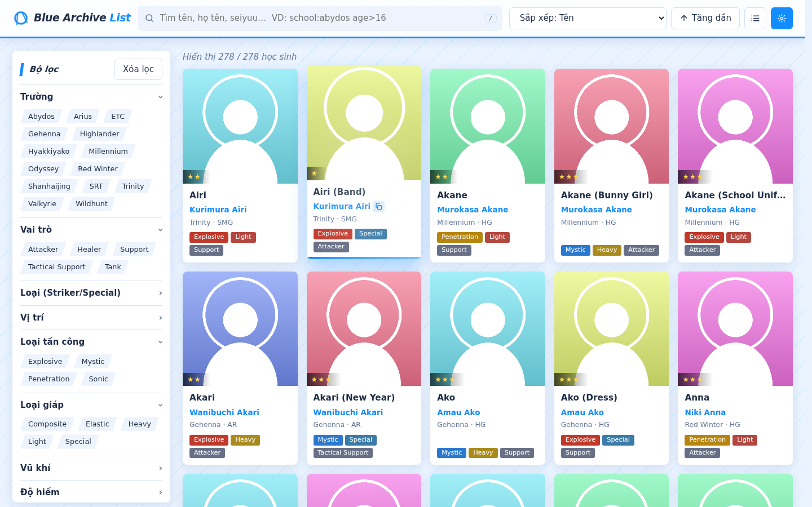
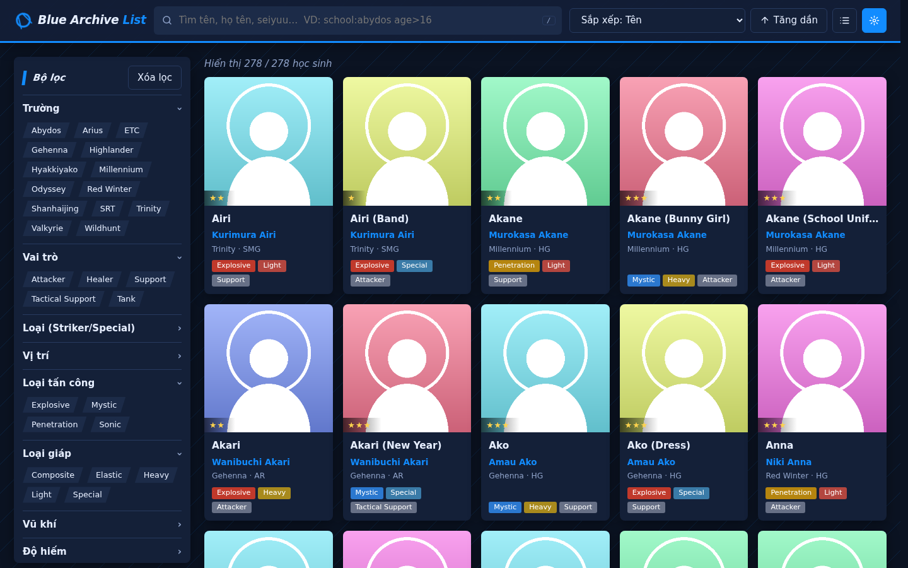
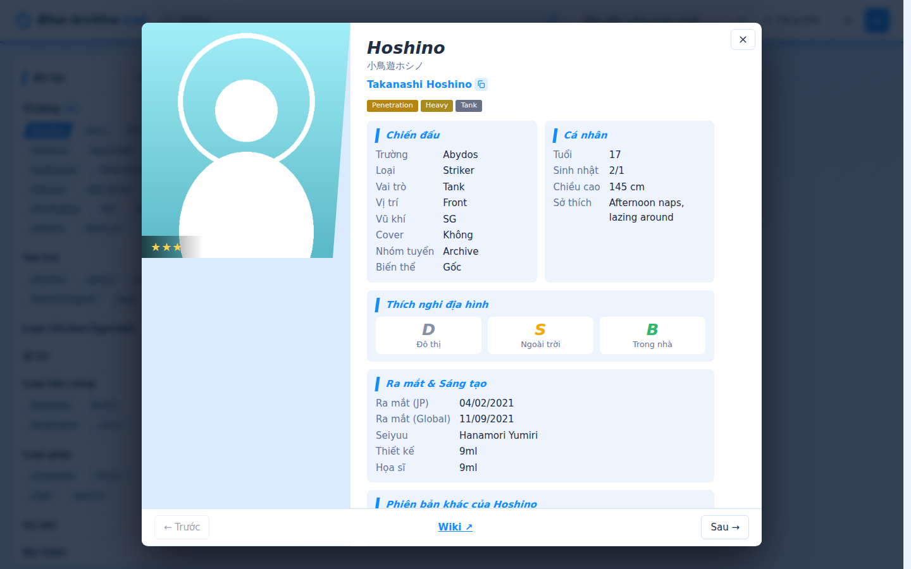
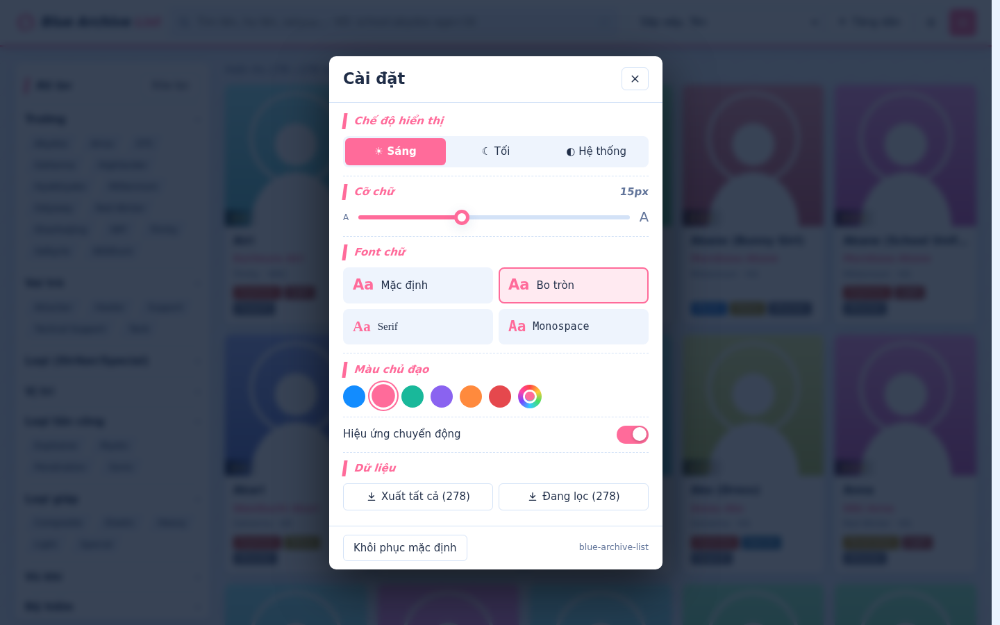
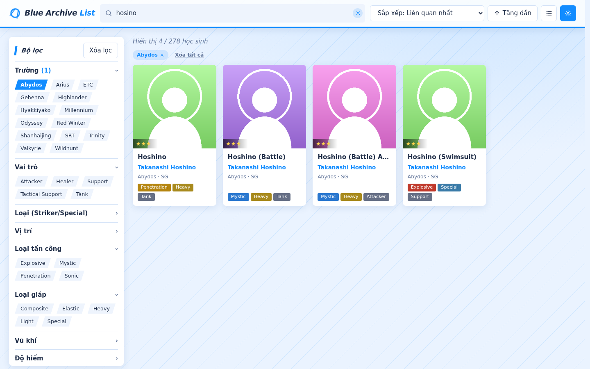
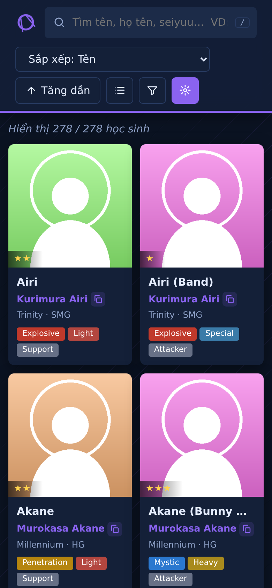

<div align="center">

# 🔷 Blue Archive List

**Danh sách & tra cứu học sinh Blue Archive — nhanh, đẹp, chạy offline.**

[](https://minhtrong67.github.io/blue-archive-list/)
[](LICENSE)


[🌐 Xem demo](https://minhtrong67.github.io/blue-archive-list/) · [🐛 Báo lỗi](https://github.com/minhtrong67/blue-archive-list/issues) · [✨ Đề xuất tính năng](https://github.com/minhtrong67/blue-archive-list/issues)

</div>

---

## Mục lục

[Giới thiệu](#giới-thiệu) · [Screenshots](#screenshots) · [Tính năng](#tính-năng) · [Cài đặt](#cài-đặt) · [Tech stack](#tech-stack) · [Development](#development) · [Build](#build) · [Cấu trúc project](#cấu-trúc-project) · [License](#license)

## Giới thiệu

**Blue Archive List** là web tĩnh giúp bạn tra cứu toàn bộ **278 học sinh** trong game Blue Archive: tìm kiếm thông minh, lọc theo nhiều tiêu chí, sắp xếp, xem chi tiết từng nhân vật và xuất dữ liệu ra JSON.

- Chỉ dùng **HTML + CSS + JavaScript thuần** — không framework, không bước build.
- **Không backend, không đăng nhập** — toàn bộ dữ liệu nằm trong `data.js`.
- Giao diện lấy cảm hứng từ phong cách của game, hỗ trợ sáng/tối, tùy chỉnh font/màu/cỡ chữ.
- Là **PWA**: cài như ứng dụng và dùng được offline.

## Screenshots

| Giao diện sáng | Giao diện tối |
| :---: | :---: |
|  |  |
| **Xem chi tiết nhân vật** | **Cài đặt giao diện** |
|  |  |
| **Tìm kiếm & bộ lọc** | **Mobile** |
|  |  |

## Tính năng

**Tra cứu**
- 🔎 **Tìm kiếm thông minh**: xếp hạng theo độ liên quan, chịu lỗi gõ sai (`hosino` → Hoshino), không phân biệt dấu tiếng Việt.
- 🧩 **Cú pháp nâng cao**: `school:abydos`, `role:tank`, `cv:mizumori`, `age>16`, `height<=155`.
- 🎛️ **15 nhóm bộ lọc**: trường, vai trò, loại, vị trí, tấn công, giáp, vũ khí, độ hiếm, nhóm tuyển, biến thể, cover, 3 loại địa hình, tháng sinh.
- ↕️ **Sắp xếp & chiều sắp xếp** theo 12 tiêu chí (tên, độ hiếm, ngày ra mắt JP/Global, tuổi, chiều cao…).
- 👁️ Hai kiểu hiển thị **lưới / danh sách**; thanh hiển thị các bộ lọc đang bật.

**Chi tiết nhân vật**
- Họ tên đầy đủ (vd `Murokasa Akane`) kèm nút **sao chép** nhanh.
- Popup chi tiết: chiến đấu, thích nghi địa hình (S–D), thông tin cá nhân, seiyuu, họa sĩ, các phiên bản khác; chuyển nhân vật bằng nút hoặc phím `←` `→`.
- Link chia sẻ trực tiếp tới từng nhân vật: `…/#Hoshino`.

**Trải nghiệm**
- 🌗 Sáng / tối / theo hệ thống, **không nháy màu khi reload**.
- 🎨 Cài đặt: cỡ chữ, font chữ, màu chủ đạo (tự chọn), bật/tắt hiệu ứng.
- ✨ Animation mượt: loading splash, skeleton, hover glare, popup, tôn trọng `prefers-reduced-motion`.
- 📤 Xuất dữ liệu **JSON** (tất cả hoặc đang lọc).
- 📱 Responsive, **PWA** (cài đặt được, dùng offline), SEO + Open Graph/Twitter Card.

**Phím tắt**: `/` focus tìm kiếm · `Esc` xóa tìm kiếm / đóng popup · `←` `→` chuyển nhân vật.

## Cài đặt

### Dùng trực tiếp (nhanh nhất)

```bash
git clone https://github.com/minhtrong67/blue-archive-list.git
cd blue-archive-list
```

Mở `index.html` bằng trình duyệt. Ảnh nhân vật tải từ `static.wikitide.net` nên cần có mạng ở lần đầu.

### Chạy bằng local server (khuyến nghị — để dùng PWA/offline)

Service Worker chỉ hoạt động qua `http(s)://`, không chạy với `file://`.

```bash
# Python
python3 -m http.server 8080
# hoặc Node
npx serve .
```

Truy cập `http://localhost:8080`.

### Deploy lên GitHub Pages

1. Push code lên repo `blue-archive-list`.
2. **Settings → Pages → Build and deployment → Deploy from a branch** → chọn `main` / `(root)`.
3. Truy cập: <https://minhtrong67.github.io/blue-archive-list/>

### Cài như ứng dụng (PWA)

Mở trang demo bằng Chrome/Edge → biểu tượng **Cài đặt** trên thanh địa chỉ (hoặc nút *Cài đặt ứng dụng* trong ⚙ Cài đặt). Trên iOS: **Chia sẻ → Thêm vào Màn hình chính**.

## Tech stack

| Thành phần | Công nghệ |
| --- | --- |
| Markup | HTML5 (semantic, `<dialog>`) |
| Style | CSS3 thuần: custom properties, Grid, `clip-path`, `color-mix()`, `:has()` |
| Logic | JavaScript (ES2020+) thuần, không thư viện |
| Offline | Service Worker + Web App Manifest |
| Animation | CSS animations + Web Animations API |
| Lưu trữ | `localStorage` (cài đặt), `sessionStorage` (splash) |
| Dữ liệu | `data.js` tĩnh — nguồn [bluearchive.wiki](https://bluearchive.wiki) |

Trình duyệt hỗ trợ: Chrome/Edge 111+, Firefox 113+, Safari 16.4+.

## Development

```bash
git clone https://github.com/minhtrong67/blue-archive-list.git
cd blue-archive-list
python3 -m http.server 8080   # sửa file → tải lại trang
```

**Cấu trúc dữ liệu** (`data.js` khai báo `const STUDENTS = [...]`), mỗi phần tử gồm:

| Trường | Ý nghĩa |
| --- | --- |
| `name`, `base`, `romaji`, `ja` | Tên hiển thị, tên gốc (không kèm trang phục), họ tên đầy đủ, tên Nhật |
| `school`/`schoolL`, `role`/`roleL`, `cls`/`clsL`, `pos`/`posL` | Giá trị chuẩn hóa / nhãn hiển thị |
| `atk`, `arm`, `weapon`, `cover`, `rarity`, `pool`, `variant` | Thuộc tính chiến đấu |
| `urban`, `outdoor`, `indoor` | Điểm địa hình `S`–`D` |
| `age`, `bd` (`MMDD`), `height`, `hobbies` | Thông tin cá nhân |
| `rjp`, `rgl` | Ngày ra mắt JP / Global (`YYYY-MM-DD`) |
| `cv`, `designer`, `illustrator`, `lobby` | Seiyuu và họa sĩ |
| `img`, `url` | Đường dẫn ảnh trên wiki, link trang wiki |

**Thêm / cập nhật nhân vật**: thêm object mới vào `STUDENTS` theo schema trên rồi tải lại trang — bộ lọc, tìm kiếm và xuất JSON tự nhận dữ liệu mới.

**Thêm nhóm bộ lọc**: thêm một mục vào mảng `GROUPS` trong `app.js` (`k` = tên trường, `l`/`f` = nhãn).

**Lưu trữ cục bộ**: `ba-cfg` (cài đặt giao diện), `ba-ui` (kiểu xem, sắp xếp), `ba-s` (đã hiện splash trong phiên).

## Build

Dự án **không cần bước build** — là tập file tĩnh, có thể deploy nguyên thư mục lên bất kỳ hosting tĩnh nào (GitHub Pages, Netlify, Cloudflare Pages, Vercel…).

Checklist khi phát hành:

1. Đổi hằng số `V` trong `sw.js` (vd `ba-list-v3`) để người dùng nhận bản mới.
2. Nếu đổi domain: cập nhật `canonical`, `og:url`, `og:image`, JSON-LD trong `index.html` và `sitemap.xml`.
3. (Tùy chọn) Minify `style.css`/`app.js` bằng công cụ bạn thích.

Đóng gói:

```bash
zip -r blue-archive-list.zip . -x ".git/*"
```

<details>
<summary>Tự động deploy bằng GitHub Actions (tùy chọn)</summary>

Tạo `.github/workflows/pages.yml`:

```yaml
name: Deploy to GitHub Pages
on: { push: { branches: [main] }, workflow_dispatch: {} }
permissions: { contents: read, pages: write, id-token: write }
jobs:
  deploy:
    runs-on: ubuntu-latest
    environment: { name: github-pages, url: "${{ steps.d.outputs.page_url }}" }
    steps:
      - uses: actions/checkout@v4
      - uses: actions/upload-pages-artifact@v3
        with: { path: . }
      - id: d
        uses: actions/deploy-pages@v4
```

Sau đó chọn **Settings → Pages → Source: GitHub Actions**.
</details>

## Cấu trúc project

```
blue-archive-list/
├── index.html              # Trang chính + SEO/Open Graph/JSON-LD
├── style.css               # Giao diện, theme sáng/tối, animation
├── app.js                  # Logic: tìm kiếm, lọc, render, popup, cài đặt, PWA
├── data.js                 # Dữ liệu 278 học sinh (const STUDENTS)
├── sw.js                   # Service Worker (cache offline)
├── manifest.webmanifest    # Cấu hình PWA
├── favicon.svg             # Favicon
├── apple-touch-icon.png    # Icon iOS
├── icon-192.png            # Icon PWA
├── icon-512.png
├── icon-maskable-512.png
├── og-image.png            # Ảnh chia sẻ mạng xã hội (1200×630)
├── robots.txt
├── sitemap.xml
├── screenshots/            # Ảnh minh họa cho README (image01 … image06)
├── LICENSE
└── README.md
```

## License

Mã nguồn được phát hành theo giấy phép **[MIT](LICENSE)** — bạn có thể sử dụng, sao chép, chỉnh sửa và phân phối tự do, chỉ cần giữ lại thông báo bản quyền.

> **Lưu ý:** *Blue Archive* và toàn bộ hình ảnh, tên nhân vật là tài sản của **NEXON Games / Yostar** cùng các bên liên quan. Dự án này là sản phẩm của người hâm mộ, phi lợi nhuận, **không liên kết hay được bảo trợ** bởi họ. Dữ liệu được tổng hợp từ [bluearchive.wiki](https://bluearchive.wiki); ảnh được tải trực tiếp từ máy chủ của wiki, không lưu trong repo.

<div align="center">

Nếu thấy dự án hữu ích, hãy tặng một ⭐ nhé!

</div>
